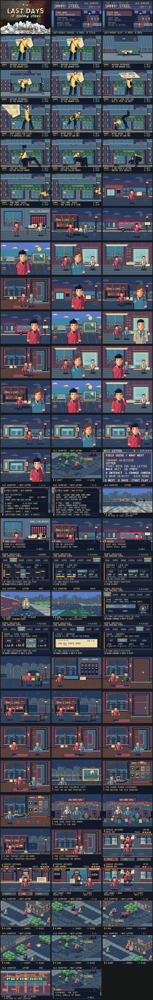
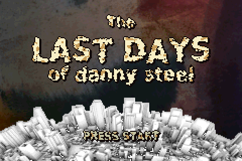
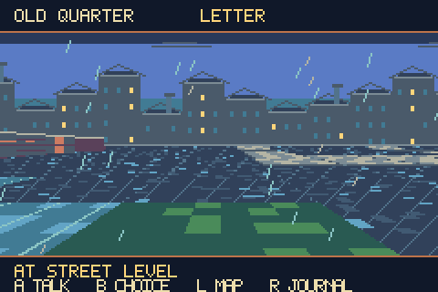
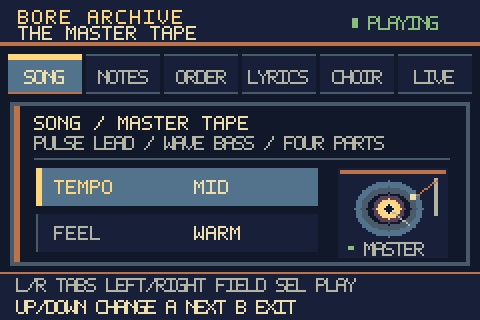
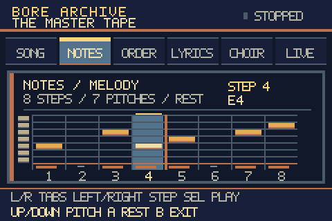
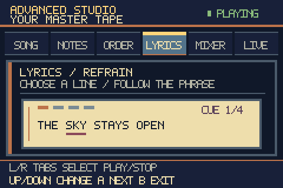

# Danny Steel — actual screenshots

These are **captures from the playable GBA ROM and the game's own
C renderer**, not generated illustrations or speculative mockups.

**Emulated, true-ROM captures (mGBA):** the first four images were taken
by compiling the current source revision to `danny_steel_title.gba` and
executing it in headless mGBA, sending
START/A inputs to navigate its opening title and new-game menus.
They were upscaled with nearest-neighbour interpolation for legibility.

**Gameplay/story engine frames:** the remaining thirteen images are made by
the exact production C rendering functions, including `hd_world_draw`,
`hd_first_person_draw`, `hd_cinema_draw` and `hd_studio_draw`,
compiled for a desktop host with the identical game art and palettes. These frames were
captured at carefully chosen story beats; they are *representative
screenshots of the code*, not a claim that one uninterrupted live run
reached every story milestone. The Advanced Studio frames use a completed-project state to demonstrate the
unlocked and fully editable interface.

## Title and main menu

| Title | Main menu | New-game save slots |
| --- | --- | --- |
|  |  |  |

The photo-texture title preserves the drifting painted background,
hand-distressed wordmark, animated skyline and mellow tonal identity.
The menu is now a native 240x160 illustration of a rainy Old Quarter street,
with printed narrative choices and no rotating-square or gray-video overlay.

## Gameplay and dialogue

| Frame | Image |
| --- | --- |
| Opening scene, as seen in mGBA |  |
| Story arrival, renderer capture |  |
| Overhead exploration |  |
| First-person exploration |  |
| Archive-side 3D view |  |
| Waterfront 3D view |  |
| BORE continuity office |  |
| Mara's café |  |
| Last bus |  |

## Unlockable Advanced Studio

| Song controls | Note editor | Arrangement |
| --- | --- | --- |
|  |  |  |

| Lyrics cue | Performing arrangement |
| --- | --- |
|  |  |

Capture source: `tools/story_gallery.c` and
`.github/workflows/screenshots.yml`. The main menu, overhead view, first-person streets, twelve key cinematic
sets and the six-tab Studio now render at native 240x160 GBA resolution.
Specialized endings, battles and some rarer investigations still use the
low-resolution fallback until they receive their own art pass. All final pictures are displayed at
2x their GBA size using nearest-neighbour scaling. No images are mockups.
