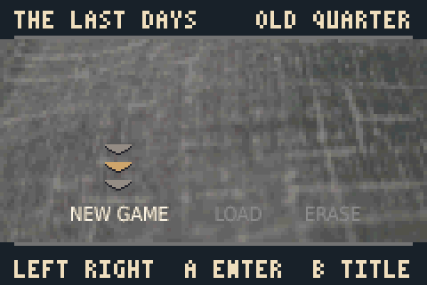
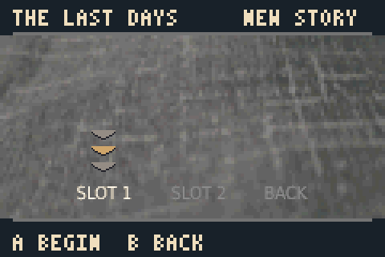
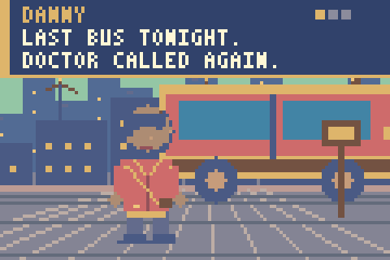
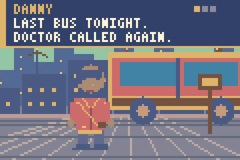
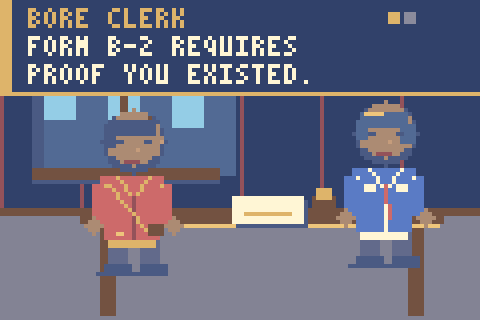
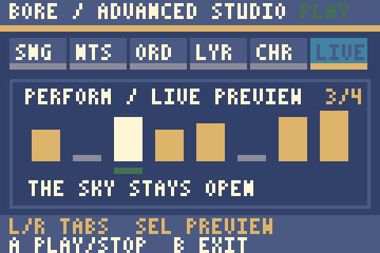

# Danny Steel — actual screenshots

These are **captures from the playable GBA ROM and the game's own
C renderer**, not generated illustrations or speculative mockups.

**Emulated, true-ROM captures (mGBA):** the first four images were taken
by executing `dist/danny_steel_title.gba` in headless mGBA, sending
START/A inputs to navigate its opening title and new-game menus.
They were upscaled with nearest-neighbour interpolation for legibility.

**Gameplay/story engine frames:** the remaining eight images came from
the actual `story_draw` and `cinema_draw` game renderer, compiled for
a desktop host using identical art and palette data. These frames were
captured at carefully chosen story beats; they are *representative
screenshots of the code*, not a claim that one uninterrupted live run
reached every story milestone. The two Advanced Studio frames use a
completed-project state to demonstrate the unlocked interface.

## Title and main menu

| Title | Main menu | New-game save slots |
| --- | --- | --- |
|  |  |  |

The photo-texture title preserves the drifting painted background,
hand-distressed wordmark, animated skyline and mellow tonal identity.
The menu uses actual looping footage and printed instructions.

## Gameplay and dialogue

| Frame | Image |
| --- | --- |
| Opening scene, as seen in mGBA |  |
| Story arrival, renderer capture |  |
| Overhead exploration |  |
| First-person exploration |  |
| BORE continuity office |  |
| Mara's café |  |
| Last bus |  |

## Unlockable Advanced Studio

| Note editor | Performing arrangement |
| --- | --- |
|  |  |

Capture source: `tools/story_gallery.c` and
`.github/workflows/screenshots.yml`. Each image retains the original
GBA pixel art, upscaled using nearest-neighbour scaling; there are
no new textures, painted-over characters, or AI-generated scenes.
