# Danny Steel — actual screenshots

These are **captures from the playable GBA ROM and the game's own
C renderer**, not generated illustrations or speculative mockups.

**Emulated, true-ROM captures (mGBA):** the first four images were taken
by compiling the current source revision to `danny_steel_title.gba` and
executing it in headless mGBA, sending
START/A inputs to navigate its opening title and new-game menus.
They were upscaled with nearest-neighbour interpolation for legibility.

**Gameplay/story engine frames:** the remaining thirty-two images are made by
the exact production C rendering functions, including `hd_world_draw`, `hd_first_person_draw`, `hd_cinema_draw`,
`hd_studio_draw`, `hd_special_cinema_draw` and `hd_ending_draw`,
compiled for a desktop host with the identical game art, palettes and
direct-from-cartridge battle illustrations. These frames were
captured at carefully chosen story beats; they are *representative
screenshots of the code*, not a claim that one uninterrupted live run
reached every story milestone. The Advanced Studio frames use a completed-project state to demonstrate the
unlocked and fully editable interface.

## Title and main menu

| Title | Main menu | New-game save slots |
| --- | --- | --- |
|  |  |  |

The photo-texture title preserves the drifting painted background,
hand-distressed wordmark, animated skyline and mellow tonal identity.
The menu is now a native 240x160 illustration of a rainy Old Quarter street,
with printed narrative choices and no rotating-square or gray-video overlay.

## Gameplay and dialogue

| Frame | Image |
| --- | --- |
| Opening scene, as seen in mGBA |  |
| Story arrival, renderer capture |  |
| Overhead exploration | 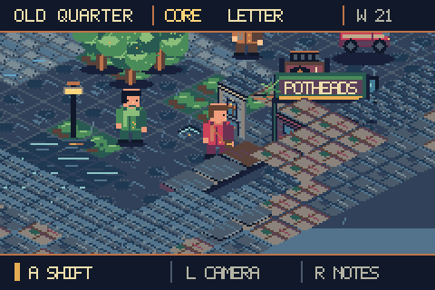 |
| First-person exploration | 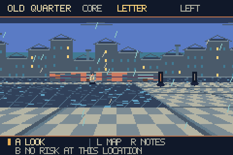 |
| Archive-side 3D view | 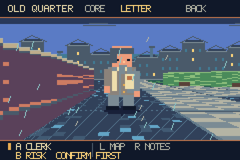 |
| Waterfront 3D view |  |
| BORE continuity office |  |
| Mara's café | 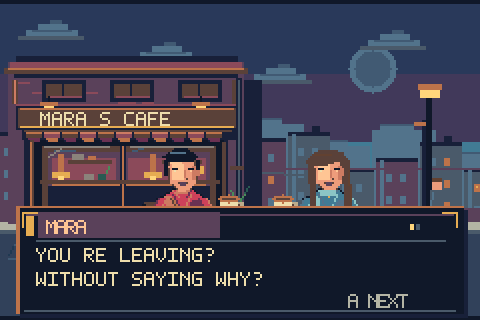 |
| Last bus | 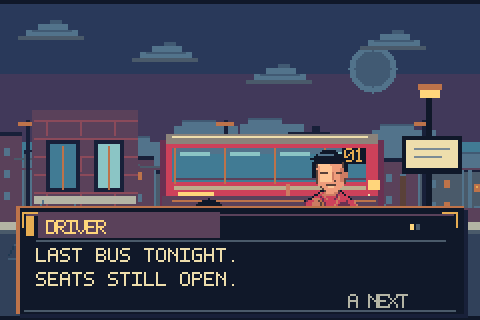 |

## Inked Old Quarter: native art direction pass (November 24)

The cinematic art uses stronger warm practical lights against subdued slate
shadows, layered building silhouettes, recessed windows, perspective floor
joints, recognizable bistro furniture and a consistent red/cream bus livery.
Danny and Mara's close-ups have distinct eye spacing, cheek and nose planes;
Mara's folded teal scarf is integrated with her costume. The menu uses
Danny's existing gameplay sprite rather than a separate block-shaped figure.

| New renderer evidence | Capture |
| --- | --- |
| Cafe staging and ceramic cups | 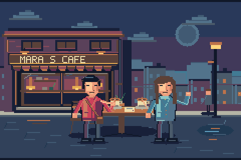 |
| Mara reaction | 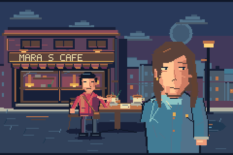 |
| Clinic interior | 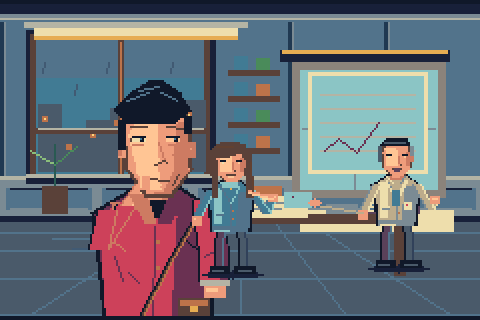 |
| Canvas underdrawing | 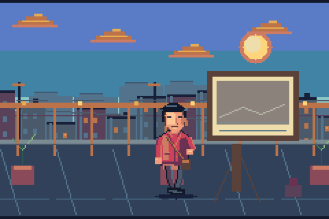 |
| Canvas silhouettes | 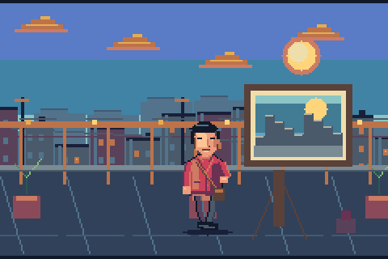 |
| Completed warm painting | 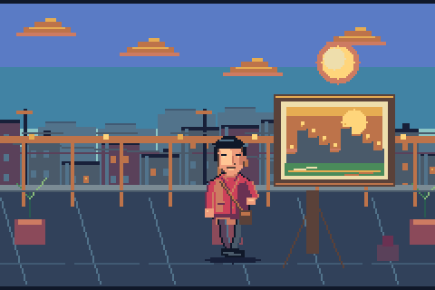 |
| Completed recording | 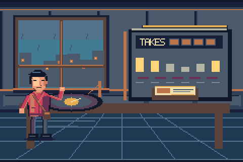 |

All are the existing native 240x160 painters. No new image atlas or
framebuffer is required, and story flags and collision are unchanged.

## Old Quarter's new cartridge-authored artwork

The overhead camera now uses its own native 16×16 pavement, masonry,
foliage and water illustrations stored as ROM pixels, plus a common
four-direction character atlas. These are **real exploration screens**,
at valid walkable locations in the original 24×18 game town, rather
than separate backdrop mockups.

| Area | Actual rendering |
| --- | --- |
| Archive plaza and townspeople | 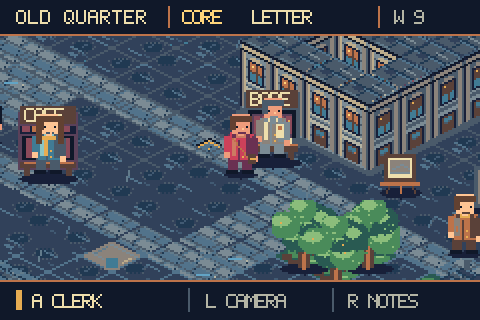 |
| Mara's street and adjacent residents | 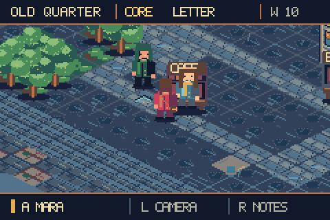 |
| Same cafe when Mara is missing | 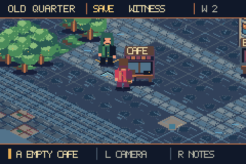 |
| Empty cafe in first person | 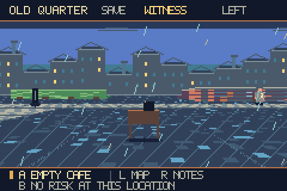 |
| Initial easel in town | 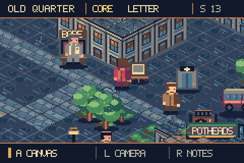 |
| Completed warm painting | 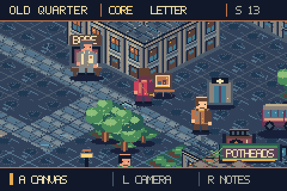 |
| Completed recording | 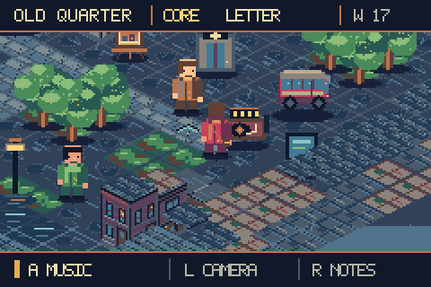 |
| Bus stop, architecture and street props | 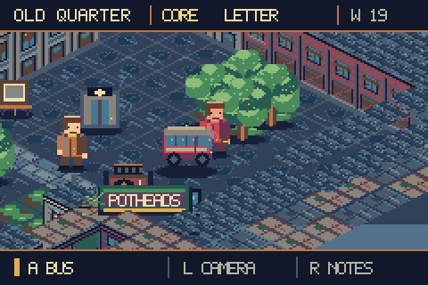 |
| Riversides and residents | 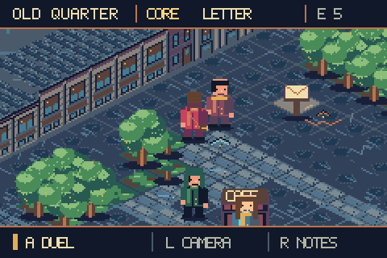 |
| Potheads' real storefront, isometric camera | 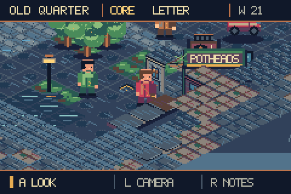 |
| Differentiated civic shop fronts | 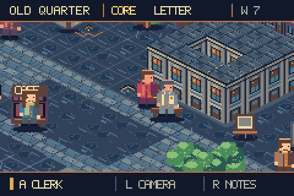 |
| Four-phase walk: contact | 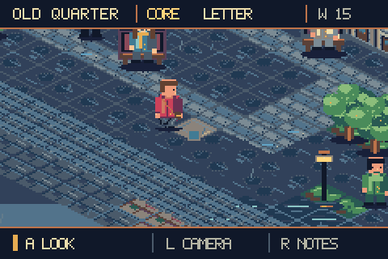 |
| Passing pose | 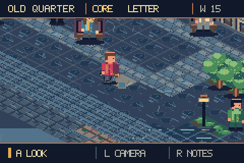 |
| Other foot contact | 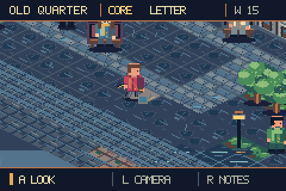 |
| Other passing pose | 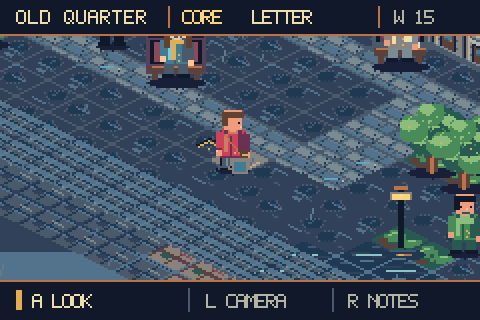 |
| Potheads' matching first-person shop wall | 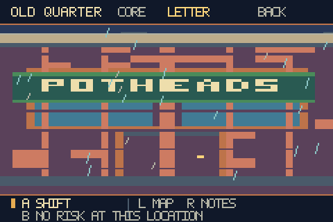 |

The original 2D and 3D views now use **the same costume cels** for named
townspeople; the same map positions, facing, interaction coordinates and
collision rules continue to determine playable movement. This art pass
does not invent additional town sectors or quests.

## Additional authored scenes and ending shots

The images below depict explicit story conditions for visual verification.
They are **not** presented as one continuous playthrough or proof that a
given ending occurs without meeting its game-state requirements.

| Scene | Actual renderer capture |
| --- | --- |
| Witness meeting and handoff | 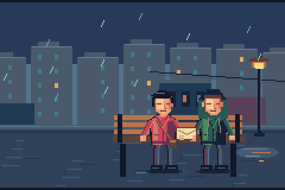 |
| Server archive evidence room | 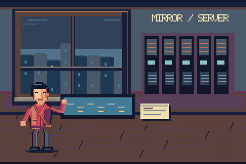 |
| Safe-house visit | 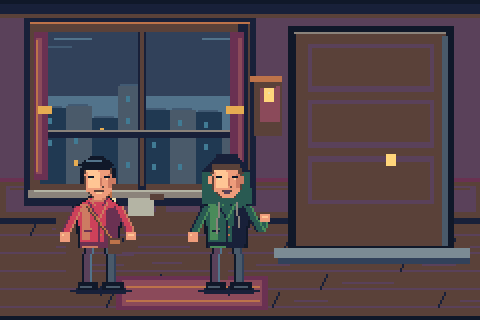 |
| Unanswered café, no confirmed recovery | 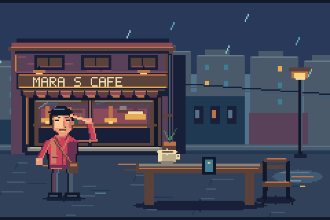 |
| Closed rescue door | 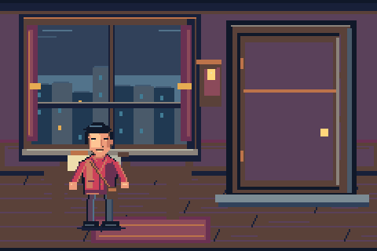 |
| Successful rescue, door opening | 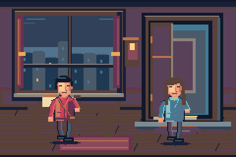 |
| Neutral ending's rooftop memories | 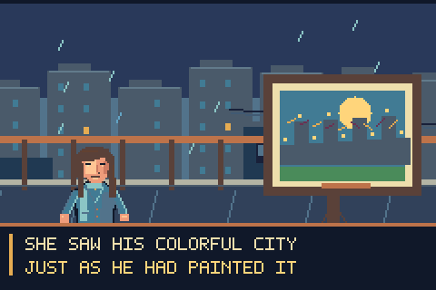 |
| Good ending's record-store legacy | 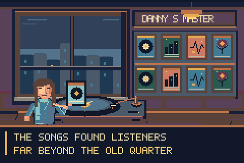 |
| Good ending's live coda | 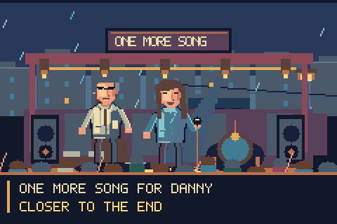 |
| Unresolved bad-ending café | 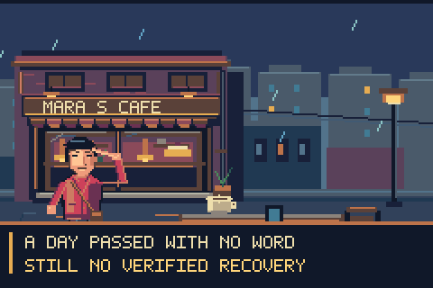 |
| Bad ending after a successful rescue | 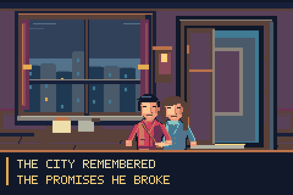 |

These keep the original conditional outcomes: the unresolved route
does not show Mara safely returning, and the rescued route does not
present her as missing. Captions are from the original timed script.

## Mirror Orchard — cartridge-illustrated native battles

These four scenes are rendered by the actual `hd_arena_draw` code at
240×160, not pixel-doubled 120×80, and use original illustrations stored
in cartridge ROM. They depict different existing story battle states:
three rival identities plus the post-investigation parry. The character
head, hat and costume ears stay visible beside the menu instructions;
the FOCUS and BEAT readouts now identify their gameplay meaning.

| Encounter | Actual frame |
| --- | --- |
| RATIO RAT, FACTS selected | 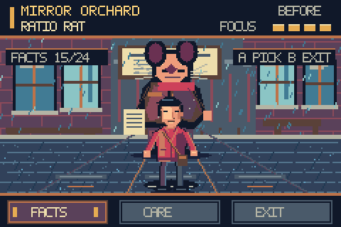 |
| BADGE LORD, CARE selected | 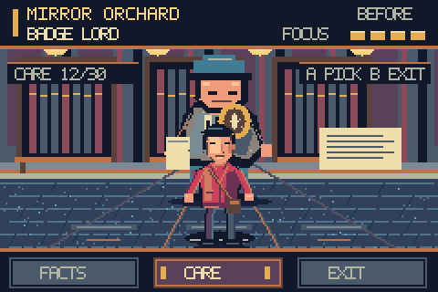 |
| LORE WARDEN, dodge and moving paper warning | 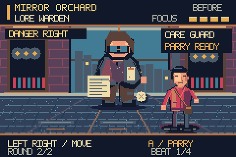 |
| REBRAND RAT, six-tick parry active | 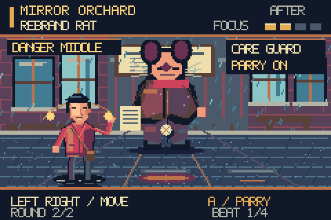 |

Combat remains a single playable, state-driven three-lane encounter; its
actual collision timing, focus, parry cooldown, exit and side-story save
effects are unchanged by the art pass. See [the native arena
notes](NATIVE_MIRROR_ORCHARD.md).

## Unlockable Advanced Studio

| Song controls | Note editor | Arrangement |
| --- | --- | --- |
|  |  | 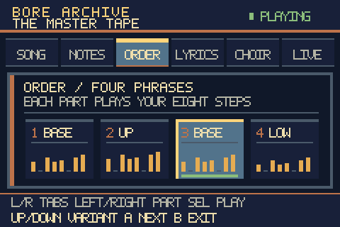 |

| Lyrics cue | Performing arrangement |
| --- | --- |
|  |  |

Capture source: `tools/story_gallery.c` and
`.github/workflows/screenshots.yml`. The main menu, authored overhead atlas, first-person streets, native
cinematic locations and the six-tab Studio render at 240x160 GBA resolution.
All 24 authored cinematic scene types and the three score-length ending
montages now render at native 240x160. The optional Mirror Orchard
combat arena also uses native 240x160 ROM-backed environments and portraits
while retaining the original game logic. All final pictures are displayed at
2x their GBA size using nearest-neighbour scaling. No images are mockups.

## Illustrated neighborhood anthology

The 42 panels in `41_*_side_*.png` are captures of actual A-button
interactions, including both alternatives at each of fourteen map sites.
`42_neighborhood_journal.png` displays completion and choices.

| Location | Opening | Left choice | Right choice |
| --- | --- | --- | --- |
| LAUNDRY | 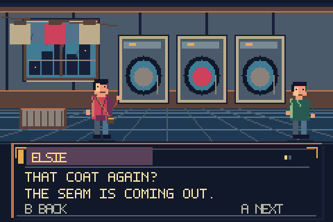 | 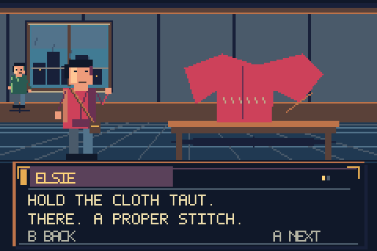 | 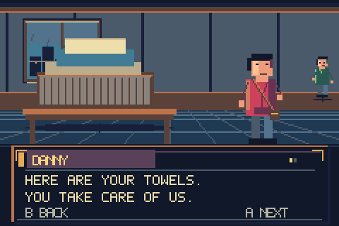 |
| PHOTO | 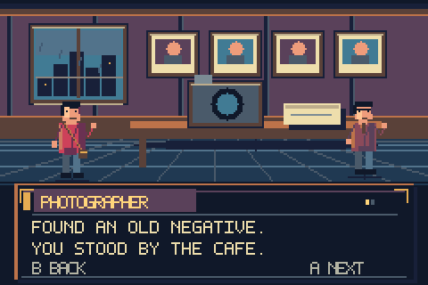 | 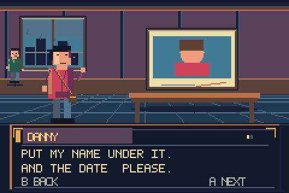 | 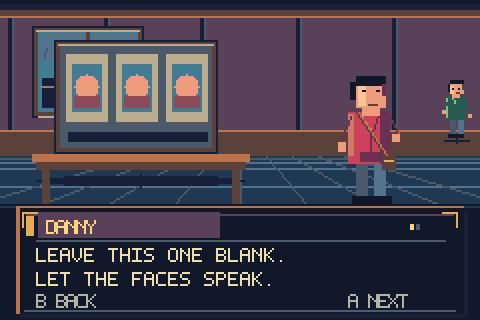 |
| STAIR |  |  |  |
| REPAIR |  |  |  |
| POST |  |  |  |
| STOOP |  |  |  |
| MARKET |  |  |  |
| ANNEX |  |  |  |
| GARDEN |  |  |  |
| SHIFT |  |  |  |
| PARK |  |  |  |
| PHONE |  |  |  |
| CANAL |  |  |  |
| SHELTER |  |  |  |
